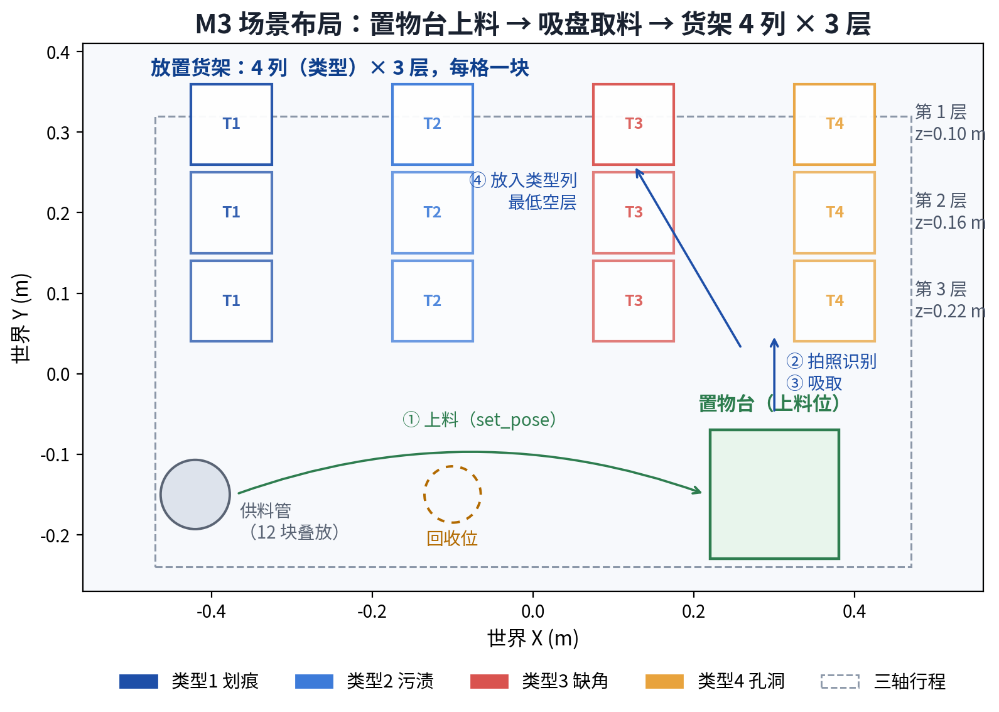
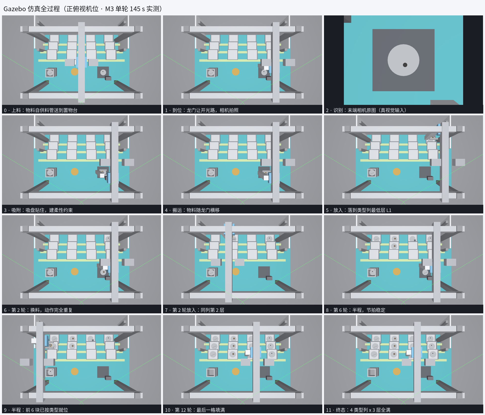

# OBS 录制操作手册（阶段性汇报 / 省赛提交视频）

> 定位：**照着做就能录出一条能交的视频**。不讲原理，只讲「点哪里、看什么、说什么」。
> 适用：2026-10-25 的 M5 版本（生成物料 → 置物台识别 → 单立柱龙门吸盘取料 → 垂直货架 4 列 × 3 层，
> 放料后盘侧套绿色指示环）。数字都是实测值，允许 ±3 s 漂移。
> 原理与排障见 `simulation_manual.md`；本文件只服务录制。

---

## 0. 录制前 60 秒清单

按顺序敲，四步都过再开 OBS。

```bash
cd ~/AIC_cv-dev

# 1) 确认没有残留实例（Fortress 的进程名是 "ign gazebo"，不是 gzserver）
ps -eo args= | grep -c "[i]gn gazebo"      # 必须是 0

# 2) 确认没有别的程序占着 8080
ss -ltnp | grep 8080 || echo "8080 空闲"

# 3) 确认没有旧产物混进来
rm -f logs/record.log

# 4) 起演示并把日志同时存一份（有显示器就加 gui:=true）
source /opt/ros/humble/setup.bash && source install/setup.bash
ros2 launch aic_dashboard dashboard.launch.py vision_backend:=trad gui:=true \
  2>&1 | tee logs/record.log
```

浏览器打开 `http://127.0.0.1:8080`，确认四件事：

| 检查项 | 合格表现 |
|---|---|
| 全景画面 | 置物台（深色台面）空着、分拣货架 4 列 × 3 层全空——**没有来料架**，12 块料停在底板下，点「生成物料」才出现 |
| 库位监视墙 | 4 × 3 共 12 格，全部灰边、无盘 |
| 末端相机 | 有画面（不是黑块/灰块） |
| 计分板 | 12 格为暗色「未完成」，比分 0 / 0 |

> **录制流程建议**：先跑一轮热身（同样这条命令），确认 12/12 且 12 格全绿；Ctrl-C 停掉。
> 然后 **开 OBS → 再敲同一条命令**，从「终端里启动」一路录到「12 格全绿定格 5 s」，
> 这样是一镜到底且包含启动过程，评审看得最清楚。`once:=true`（默认）跑完一轮会自动退出。

---

## 1. 画面怎么摆（三种方案，按可用的显示器选）

### 方案 A（推荐）：只录看板单窗口

一条命令、一个浏览器窗口、一个 OBS 源，最不容易出错，也直接满足「单窗口可录屏」这条硬指标。

```bash
ros2 launch aic_dashboard dashboard.launch.py vision_backend:=trad
```

- OBS 源：**窗口采集** → 选 Chrome/Edge 的 `AIC 判分看板` 窗口
- 画面里同时有：全景（抓取全过程）+ 末端相机（识别输入）+ 态势图（12 块物料位置）+ 12 格判分
- 缺点：没有 Gazebo 原生 GUI 的菜单栏/播放条，但**评审看的是过程与结果，不是窗口外壳**

### 方案 B：看板 + Gazebo GUI 双源（有显示器时最直观）

```bash
ros2 launch aic_dashboard dashboard.launch.py vision_backend:=trad gui:=true
```

- Gazebo GUI 会另开一个窗口：左边是模型树，下方是播放/暂停条，中间是三维场景
- OBS 用**两个窗口采集**，左右并排（左 Gazebo、右看板），或看板全屏 + Gazebo 画中画
- 注意：Gazebo GUI 窗口不要手动拖动视角（无人机位由看板按钮控制），否则「无人为干预」这条会被质疑

### 方案 C：只录 Gazebo GUI

仅在需要强调「这是真物理仿真」时用。缺点是没有判分画面，评审看不到「放对/放错」，不推荐单独使用。

> 本手册的插图全部来自 Gazebo 的 `scene_cam` 渲染管线（与 GUI 里的「全景俯视」机位同一条管线、同一帧），
> 所以你录出来的画面与手册插图在构图上是一致的，只是多了窗口边框。

---

## 2. OBS 设置（一次配好，之后不用动）

| 项 | 值 | 说明 |
|---|---|---|
| 画布分辨率 | 1920 × 1080 | 低于 1080P 会被赛区退回 |
| 输出分辨率 | 1920 × 1080 | 「设置 → 视频 → 缩放分辨率」 |
| 帧率 | 30 fps | 仿真 15 Hz 相机，30 fps 足够，码率更省 |
| 录制格式 | mp4（H.264） | 或 mkv，录完再「重新封装」成 mp4 |
| 码率控制 | CQP 18–20 | 文字与判分格要清晰，别用「低质量」预设 |
| 音频 | 默认麦克风，48 kHz | 若要旁白；纯录屏可关 |
| 源 | 窗口采集（方案 A/B） | 不要用「显示器采集」，会把桌面图标录进去 |

录制前点一次「开始录制」，看 OBS 右下角是否在走秒、磁盘剩余空间 > 5 GB。

---

## 3. 先看懂场景（录制前给自己看一遍）



四个动作，12 轮重复：① 生成物料到置物台 → ② 正上方固定相机拍照识别 → ③ 吸盘下探吸取
→ ④ 放进对应类型列的最低空层（每格一块，不叠放）。货架第 1/2/3 层高度分别是 0.10 / 0.16 / 0.22 m。

---

## 4. 分镜脚本（实测时间轴，照着念即可）

单轮实测（`logs/verify_m2_20261025_185403.log`）：**每块料约 12–14 s，整轮 2 分 25 秒–2 分 45 秒**，
加收尾定格，成片约 **3 分钟**。下表时间码按「起跑」为零点。

| 时间码 | 看板上该看到什么 | 实际事件 | 旁白（可直接念） |
|---|---|---|---|
| 0:00–0:05 | 空置物台、空货架；一块料突然出现在台面 | 「生成物料」（底板下停料区 `set_pose`） | 「ROS 2 + Gazebo 的数字孪生：每轮在置物台生成一块带缺陷的圆形铁片。」 |
| 0:05–0:08 | 龙门停在偏移位，判分格 1 变绿，日志出现 `位点 1：正确（xx）` | 固定相机拍照 → 传统视觉判型 | 「固定相机俯拍，传统视觉在 0.3 秒内判出四类缺陷：划痕、污渍、破损、孔洞。」 |
| 0:08–0:14 | 吸盘下探吸住盘、抬升、移到类型列、平推进格、松气 | 吸附 → 搬运 → 放料 | 「吸盘吸附后按类型入列，垂直货架用『前出 → 平推 → 落座』避免穿过上层托盘。」 |
| 0:14–0:16 | 该格盘边出现一圈绿边，库位墙对应格变绿 | 放料完成指示环点亮 | 「放料完成，盘侧套上绿色指示环——绿环数量就是已放料数量。」 |
| 0:16–2:3x | 上述过程重复，货架逐格填满 | 第 2–12 轮全自动 | 「后续 11 块完全自动，无人工干预；任何一次识别超时都会记 TIMEOUT 并继续。」 |
| 末 30 s | 12 格全绿、比分 12 / 0、绿环 12 个 | 终态 | 「12 块全部放对，零超时、零错放。」 |
| 末 5 s | 画面不动 | 定格 | 「视觉识别 → 行为树决策 → 龙门控制 → 物理抓放，全链路在仿真内闭环。」 |

**三句必须念到的话**（评审关注点）：

1. 「决策层零改动」——同一套行为树可以对接真机 / PLC；
2. 「视觉是传统算法，不是读真值」——`vision_backend:=trad` 就是证据；
3. 「放对变绿、放错变红，放完盘侧套绿环」——判分与指示逻辑与官方平台一致。

---

## 5. 全程画面参考（Gazebo 渲染分镜）



> 上图是 **M3 时代**的分镜（当时还是夹爪 + 阶梯货架），只用来示意「一镜到底的节奏」；
> 当前形态以 `assets/dashboard.png`（看板实拍）为准。要重抓分镜：跑起来后
> `ros2 run aic_gazebo_sim sim_snapshot.py`（抓 `/camera/image` 与 `/scene/image`）。

四类缺陷在末端相机里的样子（技术文档「图像集」页同款）：


---

## 6. 录完 3 分钟内自检（不通过就重录，别硬交）

```bash
cd ~/AIC_cv-dev

# 1) 抓放必须成对：两个数都应是 12
grep -c "吸附（吸盘使能" logs/record.log
grep -c "释放（吸盘断气" logs/record.log

# 2) 决策结果：12 条 OK、0 条 TIMEOUT
grep -c "RESULT].*OK" logs/record.log
grep -c "RESULT].*TIMEOUT" logs/record.log

# 3) 绿环：12 个放料标记
grep -c "放料标记" logs/record.log
```

| 自检项 | 合格线 | 不合格怎么办 |
|---|---|---|
| 12 格颜色 | 全绿 | 有红/琥珀 → 重录，先查 §6 |
| 比分 | 12 / 0 | 同上 |
| 吸附/断气 | 各 12 | 少一块 = 物料没放下，重录 |
| 视频时长 | 2–3 分钟 | 过短说明中途崩过 |
| 画面清晰度 | 能看清库位编号与类型字 | 提高 OBS 码率到 CQP 16 |

---

## 7. 录制中出问题怎么办（红线：不许改脚本）

| 现象 | 处置 |
|---|---|
| 看板画面黑屏 | 不要重启 OBS；等 5 s，若仍黑，Ctrl-C 重跑（本条视频作废） |
| 某格变红 / 变琥珀 | 让它跑完，记录现象，本条作废重录；不要中途干预 |
| 仿真卡住不动（> 30 s 无变化） | Ctrl-C，本条作废；按 `simulation_manual.md` §11 排查 |
| 浏览器崩了 | 重开浏览器，OBS 继续录也没意义（画面断了）→ 作废重录 |
| 录制中误触 Gazebo 视角 | 用看板「全景俯视」按钮复位，或本条作废 |

**录制期间绝对不要做的事**：改任何 `.py`/`.sh`（bash 边读边执行，正在跑的实例会当场死）、
`colcon build`、`pkill`、开第二个仿真实例（会串台）。

---

## 8. 一次录制的完整命令序列（复制即用）

```bash
# 1) 先跑一轮热身，确认 12/12（Ctrl-C 停）
cd ~/AIC_cv-dev
source /opt/ros/humble/setup.bash && source install/setup.bash
ros2 launch aic_dashboard dashboard.launch.py vision_backend:=trad gui:=true

# 2) 开 OBS 录制，再敲同一条（日志同时落盘）
ros2 launch aic_dashboard dashboard.launch.py vision_backend:=trad gui:=true \
  2>&1 | tee logs/record.log

# 3) 浏览器：http://127.0.0.1:8080
#    OBS：窗口采集该浏览器 → 跑完 12 格全绿后定格 5 s → 停止录制 → 按 §6 自检
```

> 不要再开第二条仿真：`dashboard.launch.py` 已经包含仿真本体，重复启动会抢关节指令。

---

## 9. 交付物对照

| 提交物 | 来源 | 命名建议 |
|---|---|---|
| 竞赛任务完成视频 | 本手册方案 A 的 OBS 录屏 | `AIC2026_任务完成_<日期>.mp4` |
| 参赛视频（固定机位） | 手机/相机拍选手 + 屏幕 | `AIC2026_参赛_<日期>.mp4` |
| 技术文档 | `docs/competition/AIC视觉分拣技术文档/*.pptx` | 已含编程逻辑 / 算法特点 / 图像集 |
| 程序源代码 | 本仓库 | 打 tag 或压缩包 |
