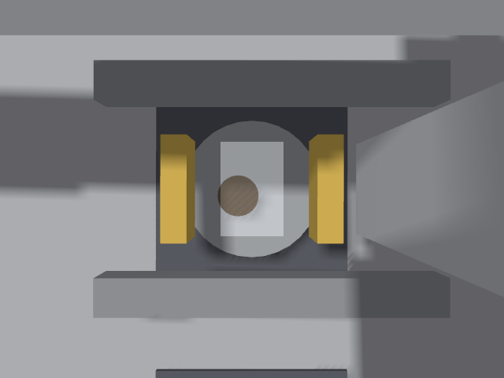
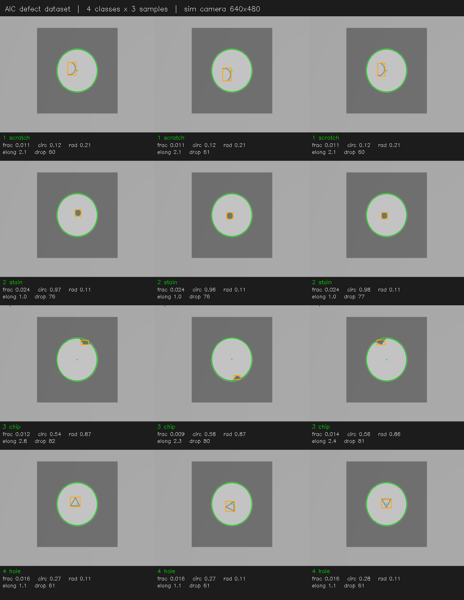

# Gazebo 仿真（M2）：12 库位 + 三轴龙门 + 抓取码放闭环

> 版本：2026-10-20（M2 端到端自验通过：真视觉 `aic_vision_trad` **12/12 四类全对**，
> 且 12 块铁片**全部落到对应类型的码放格**；单点约 6.3 s，整轮约 85 s）
> 历史：M1（2026-10-19）打通「到位 → 识别 → 记分」，单点 3.0 s。
> 代码：`src/simulation/aic_gazebo_sim/`、`src/vision/aic_vision_trad/`
> 环境：Ignition Gazebo 6.18（Fortress）+ ROS 2 Humble + ros_gz_bridge

## 1. 它在整条链路里的位置

```text
aic_behavior_tree (C++)          本包（仿真侧）
  GotoNextSlot ── /control/material_task ──► gantry_controller.py ──► /aic/joint/*/cmd_pos
                                                    │  ▲                  │ ros_gz_bridge
                                                    │  │ joint_state      ▼
                                                    │  │            Gazebo 关节控制器
                                                    │  └── /world/<w>/model/aic_gantry/joint_state
                                                    │
                                                    ├── /sim/attach_XX,/sim/detach_XX ──► DetachableJoint
                                                    ▼
  WaitVisionResult ◄── /vision/material_type ── sim_vision_node.py ◄── /sim/gantry_arrived
```

- **决策侧一行不改**（除新增的 `control_wait_ready` 握手，见第 5 节坑 10）。
- 本包的 `gantry_controller.py` 就是 **control 侧的第一个可用实现**；
  真机 control 接进来时，把本包换掉即可，话题契约不变。
- 本包的 `sim_vision_node.py` 是 **vision 侧的 ground-truth 桩**；
  `aic_vision_trad` / `aic_vision_dl` 就绪后换掉它，话题契约不变。

## 2. 场景与坐标

唯一数据源：`src/simulation/aic_gazebo_sim/config/sim_layout.yaml`。
世界文件 `worlds/aic_warehouse.sdf` 由 `scripts/gen_world.py` 生成，**不要手改**。

```text
world frame = warehouse（与 MaterialTask.header.frame_id 一致）
+X = 操作者视角「右」（4 列方向）      +Y = 「远」（row 3）
+Z = 上
库位: slot_id = (row-1)*4 + col，row 1 在 -Y（前排）
  col 1..4 → x = -0.375, -0.125, +0.125, +0.375
  row 1..3 → y = -0.1667, 0, +0.1667
台面 z = 0.10，库位地贴厚 3 mm（只有 visual，不参与碰撞）
铁片 φ80×6 mm 落在台面板上（中心 z = 0.103）
```

码放区（`place_zones:`，M2 新增）：+Y 侧另起一条 900×140 mm 的台面，4 个格口沿 X 排列：

| 类型 | 1 划痕 | 2 污渍 | 3 缺角 | 4 孔洞 |
|---|---|---|---|---|
| 格心 x | −0.36 | −0.12 | +0.12 | +0.36 |
| 格心 y | +0.30 | +0.30 | +0.30 | +0.30 |

> 真机台面 1000×500 已被 12 库位占满，龙门行程也只有 y ∈ [−0.24, 0.32]，
> 挤不下 4 个料框。仿真为了把「识别 → 抓取 → 搬运 → 按类型释放」整条动作跑通，
> 在货架后沿接了一条 120 mm 深的码放条（台面总深变 640 mm）。
> **真机布置不同时只改这里**：坐标是唯一数据源，生成器与控制器都读它。
> 同类型 3 块铁片会落在同一个格心，**因此必然叠放**（见坑 15）。

龙门（`models/aic_gantry/model.sdf`）：

| 关节 | 轴 | 行程 | 零位含义 |
|---|---|---|---|
| `x_joint` | +X | −0.45 … +0.45 | 相机在货架中线 |
| `y_joint` | +Y | −0.24 … **+0.32** | 同上（上限放到 0.32 才够到码放条） |
| `z_joint` | +Z | −0.42 … 0 | 0 = 末端最高位（夹指底面 0.135 m）；−0.04 = 抓取/放置位 |

末端：两根法兰横条 + 两根黄色夹指（x = ±0.036）+ 俯视相机
（相机在 link 内 `0 0 -0.18 0 1.5708 -1.5708`，行进高度下距铁片约 0.26 m，
视野约 0.30 m 宽，铁片占画面约 27%）。
图像方向：**右 = +X（列增大），上 = −Y（行号减小）**。



> 上面是行进高度下 3 号位点（污渍）的实拍：中间灰色圆盘是铁片，盘内棕色圆斑是
> 「污渍」缺陷，左右两根金色的是夹指，四周深灰是库位地贴。
> 该图由 `ros2 run aic_gazebo_sim sim_snapshot.py` 直接抓取。

## 3. 控制侧实现（gantry_controller.py）

- 订阅 `/control/material_task`，**FIFO 队列**逐条执行（决策是 fire-and-forget，不等回执）。
- 运动 = **协调梯形速度剖面**（`_profile()`），50 Hz 流式下发 setpoint；
  x/y 同起同停，Z 单独按 `z_speed` 走。参数在 `sim_layout.yaml` 的 `gantry:` 段
  （`xy_speed 0.30 m/s`、`z_speed 0.20 m/s`、`pick_z -0.04`、`handle_dwell_s 0.35`）。
- 任务语义：
  - `GOTO`：先抬 Z 到行进高度 → x/y 到位 → 等实际停稳 → 发 `/sim/gantry_arrived(slot_id)`
  - `HANDLE`：**下探 → 停留 → 夹持 → 抬升 → 平移到该类型的码放格 → 放下（触底即停）
    → 停留 → 释放 → 抬升 → 发 `/sim/handle_done(slot_id)`**（M2 完整搬运，单次约 5 s）。
    类型未知（0）或没配码放格时退化为「下探 + 停留 + 抬升」，不抓取 ——
    对应决策侧 `SkipSlot` 的语义（未识别不放料）。
  - `HOME`：回零位（预留）
- **抓取靠 `DetachableJoint`**：世界由 `gen_world.py` 生成时，把龙门**内联**进世界，
  再给 12 块铁片各挂一个插件（`parent_link=z_carriage`、`child_model=material_XX`、
  话题 `/sim/attach_XX` / `/sim/detach_XX`）。控制器发 `std_msgs/Empty` 经桥转成
  `ignition.msgs.Empty` 即完成夹/放。
  **开机必须主动松爪**：插件在首次 PreUpdate 就把 12 块铁片全焊到 z_carriage 上（坑 13）。
- **到位判定是闭环的**：剖面走完后进入「保持 setpoint」阶段，等
  `/world/aic_warehouse/model/aic_gantry/joint_state`（经桥转成 `sensor_msgs/JointState`）
  里目标轴的 `position` 进 `pos_tol`、`velocity` 进 `vel_tol`，连续 `confirm_ticks` 拍成立
  才报到位；超 `move_timeout_s` 按到位放行并告警。拿不到反馈时退化为固定 `settle_s`。
  实测稳态误差 0.0–1.2 mm，剖面结束后 0.08–0.44 s 判到位。
  放料那一段用独立的 `place` 步：判据是「已触底」（速度≈0 + 静差 ≤ `place_tol`），
  因为叠放的第二块必然比目标高一个片厚（坑 15）。

## 4. 视觉侧桩（sim_vision_node.py）

- 订阅 `/sim/gantry_arrived`，延时 `settle_s(0.2) + delay_s` 后发一条
  `std_msgs/String`，取值 `"1".."4"`（来自 `sim_layout.yaml` 的 `materials.types`）。
- 故障注入（复现决策侧兜底路径）：

```bash
# 60% 位点「识别失败」→ 决策记 TIMEOUT，巡视继续
ros2 launch aic_gazebo_sim sim_decision.launch.py drop_rate:=0.6 seed:=7
# 30% 位点返回非法值 "9" → 决策丢弃并计数
ros2 launch aic_gazebo_sim sim_decision.launch.py invalid_rate:=0.3
```

### 4.1 真视觉后端（aic_vision_trad）

`vision_backend:=trad` 时不起真值桩，改起 `src/vision/aic_vision_trad`：

```bash
./scripts/run_sim.sh --vision trad                              # 端到端
./scripts/run_sim.sh --vision trad --debug-dir logs/vision_debug # 存标注图（判错的现场证据）
```

链路：`/camera/image` + `/vision/trigger` → `vision_node.py` → `/vision/material_type`。
定位与判据不依赖「画面居中」：整图 Hough 找盘 + 内亮外暗环对比选优，
再做「盘内亮度基底 → 暗区连通域 → 相对盘半径归一化」的四类判据。
离线回归脚本 `scripts/bench_offline.py` 可对 `logs/vision_ds/` 里的样本一次性打分。

### 4.2 图像集图版（提交物素材）

省赛技术文档要求「图像集展示」。跑一轮带调试图的仿真后，把标注帧拼成一页图版：

```bash
./scripts/run_sim.sh --vision trad --debug-dir logs/m2_debug
/usr/bin/python3 src/vision/aic_vision_trad/scripts/make_atlas.py \
    --frames logs/m2_debug --out docs/guides/assets/vision_atlas.png
```



- 每行一类、每行 3 张，绿圈是拟合出的盘面，橙框是判据实际使用的那个暗区。
- 图下三行是**复算**的判据输入（不是抄日志），所以图和数一定对得上：
  `frac` 暗区占盘面积比、`circ` 圆度、`rad` 离盘心距离/盘半径、
  `elong` 最小外接矩长宽比、`drop` 相对盘内亮度基底的落差。
- 四类的典型值（同一批 12 帧）：

| 类型 | frac | circ | elong | rad | drop | core |
|---|---|---|---|---|---|---|
| 1 划痕 | 0.024 | 0.11 | **23.5** | 0.19 | 57 | 0.00 |
| 2 污渍 | 0.097 | 0.92 | 1.0 | 0.22 | 77 | 0.00 |
| 3 缺角 | 0.053–0.064 | 0.30 | 3.0 | **0.77** | 81 | 0.00 |
| 4 孔洞 | 0.021 | **0.98** | 1.0 | 0.32 | **123** | **0.73** |

`core` 是斑内近黑像素（< 盘内亮度 −120）的占比，专门用来认「贴着盘缘、几何量失效」的
孔洞（坑 21）。

判据顺序与间隔见 `defect_classifier.py` 的表头注释；四条判据的最小间隔都在 2 倍以上。

**泛化检验（缺陷几何随机化）**：上面 12 张是固定几何，阈值就是在这批上整定的，
等于同一个样本测了 12 次。把 `sim_layout.yaml` 的 `materials.jitter_seed` 设成非 0
（或给生成器 `--seed N`），生成器按 `(seed, slot_id)` 给每块铁片重抽缺陷的
朝向 / 盘内位置 / 尺寸（0.85–1.20 倍），约束是「盘内缺陷整体留在 0.93r 掩膜内、
缺角压在 0.90–0.96r 盘缘」—— 类型不变，所以视觉真值不受影响。

关掉随机化（`jitter_seed: 0`）时生成物与 M2 **逐字节一致**（`git diff` 为空），
这条本身就是「几何参数化没改动既有行为」的回归证据。

一键多种子回归（每个种子约 85 s，结束时自动把世界恢复成基线）：

```bash
./scripts/verify_sim_robust.sh --frames 1 2 3 4 5   # --frames 顺手存调试图
```

| seed | 决策 | 单轮耗时 | 说明 |
|---|---|---|---|
| 1 | 12/12 OK | 83 s | |
| 2 | 12/12 OK | 83 s | 第一次跑被「改脚本」误杀（坑 22），改回来复跑通过 |
| 3 | 12/12 OK | 82 s | |
| 4 | 12/12 OK | 82 s | |
| 5 | 12/12 OK | 82 s | 存了调试图 |

合计 **60 个位点 0 误判**；seed 2 / 5 的 24 帧离线复算也是 0 错（`make_atlas.py` 的
`--features-csv` 会把每帧的判据输入写出来）。随机几何下 6 帧/类的分布：

| 类型 | frac | circ | rad | elong | drop |
|---|---|---|---|---|---|
| 1 划痕 | 0.024–0.029 | 0.10–0.16 | 0.05–0.22 | 17.6–27.9 | 54–58 |
| 2 污渍 | 0.082–0.116 | 0.93–0.94 | 0.09–0.48 | 1.0 | 76–78 |
| 3 缺角 | **0.033**–0.083 | 0.31–**0.72** | 0.73–0.80 | 1.3–2.7 | 82–84 |
| 4 孔洞 | 0.016–0.022 | 0.96–0.98 | 0.17–0.73 | 1.0–1.1 | 122–124 |

必须记住的四条：

- **划痕 `elong` 下限从 23.4 掉到 17.6**（阈值 12，余量 1.5×）。朝向随机后细条在像素
  网格上更容易「变粗」，`elong` 会低 —— 这就是阈值不能贴着 23 取的原因。
- **缺角 `frac` 下限 0.033**（阈值 0.020，余量 1.65×），比固定几何的 2.6× 收窄。
  但**不能往上调**：圆精修被拒、退回 Hough 整像素圆时 M2 实测 `frac` 会掉到 0.030。
- **缺角 `circ` 上限 0.72 已越过孔洞的 0.70 闸门**，能分开靠的是 `drop ≥ 100`
  （缺角 82–84 / 孔洞 122–124）和 `frac ≤ 0.045` 两道独立闸门 —— 这也正是坑 21
  要再加「近黑核心」的原因：别让单条几何量独自承担分类。
- 精修被拒 1/24，该帧仍判对 → 回退路径有效。

## 5. 踩过的坑（改仿真前必读）

1. **物理系统不会自动加载**。本机 Fortress 在有 `<physics>` 段时**不**自动装
   `Physics` system，且 dartsim 引擎库在 `ign-physics-5/engine-plugins/`，
   默认搜索路径找不到。表现极具迷惑性：世界能起、时钟在走、相机出图，
   **但什么都不动**（自由落体都不落）。
   解法：世界 SDF 里显式
   `<plugin filename="ignition-gazebo-physics-system" name="...Physics"><engine>ignition-physics-dartsim-plugin</engine></plugin>`
   + launch 里补 `IGN_PHYSICS_ENGINE_PATH`。
   **一分钟自检**：放一个自由落体球，2 s 后看 `pose/info` 里它掉没掉。
2. **`joint_index` 是「该关节内部的自由度序号」**，不是「模型里第几个关节」。
   三个单自由度 prismatic 全部填 `0`；填 `0/1/2` 时只有 X 能动，Y/Z 静默失效。
3. **没有 `SceneBroadcaster` 就没有 `/world/<w>/state` 与 `pose/info`**：
   `ign model -m ... -l ...` 会一直 "Service call timed out"，
   你会误判成"服务不通/沙箱问题"。
4. **关节反馈要看对话题**：`/world/<w>/pose/info` 里 prismatic 的 `axis1` 确实缺省
   （那是「位姿」话题，不是「关节」话题）；但 **`JointStatePublisher` 发的
   `/world/<w>/model/<model>/joint_state` 是有 `position`/`velocity` 的**，桥成
   `sensor_msgs/JointState` 即可（`JointState[ignition.msgs.Model`）。
   早期把它误判成「不回传」，于是用「剖面 + 定时」判到位，代价见坑 11。
5. **Z 轴（竖直 prismatic）会被重力拉到底**：位置控制器是速度伺服，
   在 controller 起来之前的窗口里 Z 会滑到下限，之后**卡在下限爬不回来**。
   M1 直接给 `z_carriage` 关掉重力（`<gravity>false</gravity>`），
   位置保持完全交给控制器；恢复真实重力时要配制动/重力前馈。
   另外控制器**必须每拍都下发**（不只是运动时），否则 Z 会继续下沉。
6. **ros_gz_bridge 方向符**：`topic@ros_type]gz_type` 是 ROS→GZ（右括号），
   `topic@ros_type[gz_type` 是 GZ→ROS（左括号）。写反了桥会"建好了"，但一条都收不到。
7. **相机不能与 Z 立柱同轴**：立柱是实体视觉，相机埋在里面拍到的是"管子内壁"。
   现在立柱偏到 x = −0.075，法兰做成两根横条，中间留光路。
8. **`declare_parameter(name, 0.5)` 会把类型钉死 double**：
   命令行 `-p count:=5` 传进来是 INTEGER，rclpy 抛
   `InvalidParameterTypeException`，节点**启动即崩**（表现为"抓图没输出"）。
   本包统一用 `sim_layout.declare_number()`（`dynamic_typing`）规避。
9. **`HOME` 缺失**时 ign gazebo 会把日志/缓存退化到 `/.ignition` 并刷警告，
   容器/CI 里要显式给 `HOME`（launch 已兜底）。
10. **首条 GOTO 会丢**：决策是 fire-and-forget，control 订阅尚未建立时消息直接蒸发，
    表现是「第 1 个位点必然 TIMEOUT」。解法：仿真 control 周期发 `/control/ready`，
    决策侧 `control_wait_ready=true` 时先等就绪再开跑
    （`bt_runner.cpp` 里新增的等待段，超时 `control_ready_timeout_s=10 s`）。
11. **「剖面走完」≠「机台到位」**（最贵的一个坑，2026-10-19）。
    初版 `JointPositionController` 用 `p_gain=20 / d_gain=0.6`，伺服严重欠阻尼：
    375 mm 阶跃实测「1.25 s 剖面结束 → 4.8 s 才追上 → 过冲 17.7 mm → 8.6 s 才停稳」。
    而控制侧在剖面 + 0.15 s 就报到位，那一刻实际位置差 185 mm，**相机画面偏一整格**，
    视觉必然判不出铁片；看起来像「相机出图滞后 2 s」，其实是机台还没到。
    两个修正缺一不可：
    - 增益提到 `p=1600 / d=200`（过冲 0.5 mm、约 1.9 s 进 ±1 mm）；
    - 到位改闭环（读 `joint_state` 的 position/velocity），不再数时间。
    另外做了对照实验才排除「渲染排队」：相机从 20 Hz 降到 5 Hz，画面差异**完全没有改善**，
    同一位置 +0.9 s 与 +2.8 s 两帧仍不同 —— 说明瓶颈不在渲染。
12. **`WaitVisionResult` 的窗口从「GOTO 下发」开始计时，不是从「到位」开始**。
    控制器是 FIFO，GOTO(N+1) 下发时队列里还压着 HANDLE(N)（M2 的完整搬运 ≈ 4.3 s），
    再加 GOTO 自身 ≈ 1.5 s，`vision_timeout_s` 必须覆盖「HANDLE + GOTO + 视觉延迟」。
    偏小的后果不是「慢」，而是**迟到的结果被下一个位点当成自己的答案收下**
    （类型错位，而结果表仍显示 OK）。
    实测：M2 下成功位点的等待落在 5.4–8.4 s，8.0 只剩 0.1 s 余量 → 稳定丢 3 个；
    现默认 **12.0**。真机 HANDLE 不含搬运（夹爪一开一合），参数应按真机节拍重定。
13. **`DetachableJoint` 不是「等 attach 话题才连」——它在首次 `PreUpdate` 就把 child 焊上**
    （最坑的一个，2026-10-20）。Fortress 版插件只认 `parent_link` / `child_model` /
    `child_link` / `attach_topic` / `detach_topic` / `output_topic` 六个字段，
    **没有 `initial_attach` 开关**。12 个插件 = 12 块铁片开机全挂在 z_carriage 上：
    静置 Z 被压到 **−3.675 mm**，正好等于 `12 × 0.05 kg × 9.81 ÷ p_gain(1600)`，
    而速度恒为 0 —— 闭环判据（pos + vel 双阈值）永远等不到，每段 Z 都「到位超时 8 s」。
    更隐蔽的是**指令一下发就动不了**：铁片焊在末端，Z 8 s 只走了 0.2 mm（目标 −0.04，
    实际 −0.0002，误差 39.8 mm）。
    解法：开机广播几轮 `detach` 把 12 块全部放开。两个前提缺一不可：
    - 等**第一帧 `joint_state`** 再发（它同时证明 bridge 已起、ROS→GZ 的 24 个订阅已建好）；
    - **`/control/ready` 等松爪跑完再发**。实测决策端在控制器启动后 0.02 s 就发来
      第一条 GOTO，若用「收到任务就停发」来保护，松爪会被永久跳过。
    自检：静置 `z_joint.axis1.position` 应 ≈ 0（现在是 −1e−48），铁片 z 应 ≈ 0.103。
14. **`<collision>` 漏写 `<pose>`：碰撞体与可视体错位 90 mm**。
    `rack` 的台面 visual 有 `pose z=top_z−0.01`，collision 没写 → 碰撞板落在 link 原点
    （z ∈ [−0.01, 0.01]）。铁片还是 `static` 时完全看不出来；一改动态就**整批掉到这块
    看不见的碰撞板上**（实测全部停在 z = 0.013，而相机里看台面还是 0.10，视觉跟着失配）。
    `place_table` 更狠：collision 连 Y 也没给，落在 y = 0（货架下方），码放到 y = 0.30
    的铁片会直接穿到地面。**凡是 visual 带 pose 的，collision 必须给同一份 pose。**
15. **同类型铁片会叠放，「精确到位」判据必然超时**。
    12 个位点 / 4 个类型 = 每格 3 块，第二块落在第一块上，比目标高**一个片厚 6 mm**，
    第三块高 12 mm。用「位置±3 mm + 速度≤10 mm/s」判，Z 永远差 6 mm → 每块白等
    `move_timeout_s`（实测 8 s），**而且会把下一个位点的视觉窗口挤爆**，连锁出 3 个
    TIMEOUT + 类型错位。解法：放料单独用 `place` 步，判据改成「已触底」：
    残余速度 ≤ 3 mm/s 且静差 ≤ `place_tol(15 mm)`。日志里打印「已触底（静差 X mm）」。
16. **图像订阅 `depth` 不能是 5**：识别（Hough）在定时器里跑几十毫秒，期间图像回调在
    队列里排队，depth=5 时执行器会把 5 帧旧图逐帧送进来 → 「到位后第一帧」可能还是
    0.25 s 前运动中拍的（实测整盘偏出画面中心 30 px，被当成污渍）。
    订阅端改 `depth=1`（只要最新一帧）+ `settle_skip_s` 0.15 → 0.25 s。
17. **缺角的 `frac` 阈值不要贴着实测值**：`frac` 用**估计出的盘半径**归一化，
    而 Hough 半径在同一台相机下有 ±9% 抖动（实测 80.3 px vs 87.3 px）。
    r 偏小时 0.93r 的掩膜会把压在盘缘的缺角切掉大半，`frac` 从 0.072 掉到 0.030 ——
    原来 0.035 的阈值正好卡在实测边缘，12 位点里会漏 1 个（判成污渍）。
    现改 0.020；真正挡住「圆柱侧壁暗沿」的是 `elong ≤ 5`（侧壁实测 7.4–11.3）。
18. **Hough 的圆半径会抖 ±9%，凡按半径归一化的量都会跟着抖**（2026-10-20）。
    `HoughCircles` 的输出落在 `dp` 网格上（dp=1.2 → 坐标是 1.2 px 的整数倍），
    同一相机同一高度下逐帧半径在 80.3~87.4 px 之间跳、圆心 `cy` 差 7 px。
    而 `frac` / `rad` 全按盘半径归一化：r 小 9%，0.93r 掩膜就把压在盘缘的缺角切掉大半。
    解法：`find_disc_global()` 末尾统一调 `refine_circle()`（径向边缘扫描 +
    Kasa 拟合），并把结果用「内点占比 ≥0.45、|dr|/r ≤0.12、残差 ≤1.5 px」筛一遍，
    不合格就退回 Hough 圆（日志里会标「精修被拒」）。
    实测组内半径抖动 2.30 px → 0.10~0.49 px，四类特征的帧间散差随之塌到 1e-3 量级。
19. **决策一退出就 `Shutdown`，最后一块料还在夹爪里**（2026-10-20）。
    决策发完最后一个 `HANDLE` 就结束进程，但 HANDLE 是 fire-and-forget：
    控制器 FIFO 里还压着它（夹持 + 搬运 ≈5 s）。旧写法 `OnProcessExit → Shutdown`
    立刻关仿真，结果 **12 次 attach 只有 11 次**、第 12 块铁片始终留在货架上
    （CSV 却显示 12/12 OK，只看结果表完全发现不了）。
    解法：`OnProcessExit → TimerAction(shutdown_grace_s=12) → Shutdown`。
    自检：日志里 `夹持（DetachableJoint attach）` 与 `释放（… detach）` 各应为 **12**。
    做省赛视频时这条尤其致命 —— 少放一块料，成绩就少一分。
20. **仿真可能整条 run loop 卡死**（ogre2 无头 + 12 个 DetachableJoint 长时间跑，
    偶发）：`gzserver` 进程还在、无任何报错，但 `joint_state` 不再更新、相机也不再出帧。
    现场表现是「到位超时 + 视觉超时」，极易误判成控制或视觉挂了。
    控制器现在有关节反馈看门狗：断流 2 s 打一条 error，提示
    「自检 `ign topic -e -t /clock` 看时间戳是否还在走」。
21. **孔洞贴着盘缘时，圆柱侧壁的阴影会和孔口连成一块，几何判据全部失效**（2026-10-20）。
    缺陷几何随机化（`jitter_seed=7`）后跑出来一个：真值孔洞、被判成缺角。
    该连通域 `circ` 从 0.98 掉到 **0.34**、`elong` 1.0→2.1、`rad=0.78`、`drop=101` ——
    几何上就是个缺角，`drop` 又正好夹在缺角 81–86 与孔洞 123 之间，光看亮度也分不开。
    解法：加一条**近黑核心**判据 —— 孔是通透的，斑内 `< 盘内亮度−120` 的像素占
    **0.23–0.75**，而划痕/污渍/缺角实测全是 **0.000**。阈值取 0.05，余量 4 倍以上。
    这条判据放在「缺角」之前，且不依赖 `circ`/`frac`，所以贴边与否都能认。
22. **跑仿真时改 `scripts/*.sh` 会被误诊成「仿真卡死」**（2026-10-20 实测）。
    bash 是边读边执行的：脚本跑到一半被改写，正在跑的实例会读到半截报
    `unexpected EOF while looking for matching '`，随即退出并触发它自己的 `cleanup`
    —— 桥被 `SIGINT` 掉，`ros2 launch` 里其余节点还活着。现场就是
    「`joint_state` 断流 + 相机不再出帧 + `/clock` 采不到」，与坑 20 的 run-loop 卡死
    **肉眼无法区分**。区分办法：在 launch 日志里找
    `signal_handler(SIGINT/SIGTERM)` 与 `process has finished cleanly` —— 有这两行就是桥被杀了，不是仿真死了。
    实测 seed 2 第一次跑只有 1/12，改回脚本后同一 seed 复跑 12/12。
    同理 **不要在同一台机器上并发起第二套仿真**（推断：共用 GZ 分区与
    `/world/aic_warehouse/*` 话题名，会互抢订阅/服务；未做对照实验）。
    改脚本前先确认没有仿真在跑：`pgrep -af gzserver`。

## 6. 已验证 / 未做

**一键自验**：`./scripts/verify_sim_m2.sh`（约 100 s）。起真视觉跑一整轮，等日志里第 12 次
`detach` 出现（**不用固定 sleep**，否则最后一块还在飞行中就被 kill），抓 `pose/info`，
再调 `scripts/check_sim_m2.py` 断言三组：

| 组 | 断言 |
|---|---|
| A 决策结果 | 12 行全 `OK`；每个位点按 `slot_id` 查 `materials.types`，类型逐位一致 |
| B 夹持闭环 | 日志 `夹持` 与 `释放` 各 12 条（只数 attach 会漏掉坑 19） |
| C 物理落位 | 12 块铁片 x 与格心差 ≤4 mm、y 与码放条中心差 ≤4 mm、z 在台面高度区间 |

`--vision gt` 可切真值桩，用来把「视觉判错」与「控制/物理问题」分开。
负向自测：拿 `drop_rate:=0.6` 的结果喂进去，A2/A3/B1/B2 全报 FAIL（脚本本身也验过）。

**缺陷几何随机化回归**：`./scripts/verify_sim_robust.sh --frames 1 2 3 4 5`
（5 个种子 × 12 位点，约 7 min）。零假设是「阈值只在那 12 张固定图上成立」；
实测 **60 位点 0 误判**，判据输入分布与余量见 §4.2 的表。

**已验证（2026-10-20，M2）**

- **真视觉 + 完整搬运，单轮 12 位点：OK 12 / TIMEOUT 0，四类全对**
  （划痕 3 / 污渍 3 / 缺角 3 / 孔洞 3，与 `materials.types` 逐位一致），平均单点 6.3 s，
  整轮约 85 s（另加 `shutdown_grace_s` 12 s 收尾）。
- **落位核对**：同一次闭环（真视觉 → 决策 → 抓取 → 码放）跑完后，
  从 `/world/aic_warehouse/pose/info` 读 12 块铁片的最终世界坐标：

  | 类型 | 格心 x | 落位铁片 | 实测 x | 实测 z |
  |---|---|---|---|---|
  | 1 划痕 | −0.36 | slot 1 / 6 / 10 | −0.3592 / −0.3592 / −0.3592 | 0.103 / 0.109 / 0.115 |
  | 2 污渍 | −0.12 | slot 3 / 5 / 11 | −0.1192 / −0.1192 / −0.1192 | 0.103 / 0.109 / 0.115 |
  | 3 缺角 | +0.12 | slot 2 / 8 / 9 | 0.1208 / 0.1208 / 0.1209 | 0.103 / 0.109 / 0.115 |
  | 4 孔洞 | +0.36 | slot 4 / 7 / 12 | 0.3608 / 0.3608 / 0.3608 | 0.103 / 0.109 / 0.115 |

  x 与格心差 0.8 mm（夹指半开 36 mm、片半径 40 mm，落点受夹指间隙约束）；
  y 全部 0.2987（比格心靠里 1.3 mm）；z 每叠一块正好 +6 mm（片厚），
  说明「叠放」是物理结果而非穿模。
- **夹持 / 释放 12 对全部成对出现**（日志各 12 条），8 次「已触底」，**0 次到位超时**。
  这一条是坑 19 的回归检查项：只数 attach 不够，必须 attach 与 detach 都等于位点数。
- 单点抓放探针（只跑 slot 1）：铁片从 (−0.375, −0.1667) 精确落到 (−0.360, 0.300)，
  其余 11 块原地不动。

**M1 遗留（仍有效）**

- 真值桩单轮 12 位点闭环：OK 12 / TIMEOUT 0，平均单点 3.03 s。
- 故障注入：`drop_rate:=0.6` → 巡视跑完，`FAILURE` 不出现。
  **M2 节拍下已复测**（2026-10-20）：OK 4 / TIMEOUT 8 / 夹持 4，平均单点 9.1 s、
  整轮约 125 s。结论与 M1 一致，只是失败位点从「等 5.4 s」变成「空等 12 s」——
  `vision_timeout_s` 调大的代价是明确的，真机把 HANDLE 压短后应同步收小。
- 到位精度：反馈判定，稳态误差 0.0–1.2 mm；无头 EGL 出图；
  `ros2 launch` 在决策退出后自动关停（M2 起带 `shutdown_grace_s` 宽限）。
- **圆精修**（坑 18）：组内半径抖动 2.30 px → 0.10~0.49 px，
  四类特征帧间散差塌到 1e-3 量级；精修被拒时日志会标「精修被拒」。

**未做**

1. **GUI 交互**：现在 `gui:=true` 只起观察窗口，没有做模型拖动/摆位工具。
2. **视觉从仿真迁移到实拍**：`aic_vision_trad` 的阈值是在渲染图上标的
   （背景单一、无光照变化、缺陷是几何体）。实拍要重标：先固定相机→盘面距离，
   再按「盘半径像素」归一化（几何量现在已经是相对量，换尺度只需改 `disc_rmin_frac`）；
   另外缺角的 `frac` 依赖盘半径估计精度（坑 18）：`refine_circle()` 的
   `refine_grad_min`（默认 6 级灰阶）是按渲染图的边缘对比度定的，实拍要按新图重调，
   否则精修会频繁被拒、退回 ±9% 抖动的 Hough 圆。
3. **多格位扩展**：现在每个类型只有一个格心（3 块叠放）。若真机是「一个料框一条，
   框内并排」，把 `place_zones` 改成 `xs` 二维（每型多个落点）即可，控制器只读它。
4. **夹爪几何**：现在夹指是两根静止的黄色方块，靠 `DetachableJoint` 做「吸附」，
   没有真正的开合关节与夹持力。要更真实可换 `ros2_control` + 两指 prismatic。
