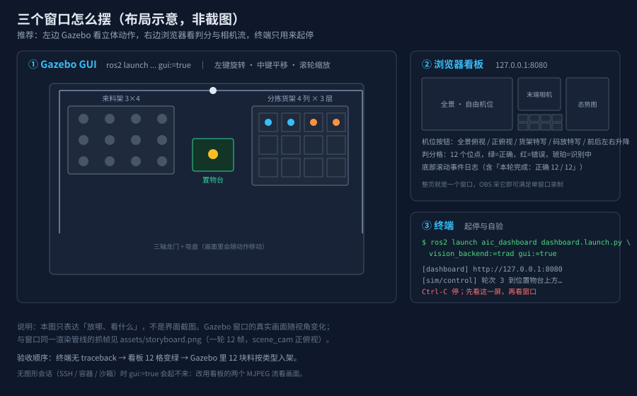

# 可视化窗口操作手册

> 版本：2026-10-22 · 对应 M4（来料架 3×4 → 置物台识别 → 分拣货架 4 列×3 层）
> **这份手册只管"窗口"**：怎么把画面调出来、窗口里该看到什么、看不到时先查哪里。
> 判据与验收顺序看 `acceptance_manual.md`；录视频看 `obs_recording_playbook.md`。

---

## 1. 三个窗口，各看一件事



| 窗口 | 看什么 | 怎么开 |
|---|---|---|
| ① Gazebo GUI | 立体动作：龙门怎么走、吸盘怎么下探、料怎么入格 | `gui:=true`（见 §2） |
| ② 浏览器看板 | 判分（12 格绿/红）+ 两路相机 + 态势图 | 开 `http://127.0.0.1:8080` |
| ③ 终端 | 起停、报错、每轮耗时 | 就是起服务的那个终端 |

日常演示**只开 ②** 就够（单窗口，OBS 采集最省事）；要讲"物理仿真"时再加 ①。

---

## 2. 一分钟把窗口调出来

```bash
cd ~/AIC_cv-dev
source /opt/ros/humble/setup.bash
source install/setup.bash

# 一条命令同时起：Gazebo（带窗口）+ 视觉 + 控制 + 决策 + 看板
ros2 launch aic_dashboard dashboard.launch.py vision_backend:=trad gui:=true
```

然后在浏览器打开 **`http://127.0.0.1:8080`**（Chrome / Edge 均可，无需联网）。

期望顺序（按时间）：

| 时刻 | 终端 | 看板 | Gazebo 窗口 |
|---|---|---|---|
| 0–8 s | `process started` 若干行 | 页面能打开，12 格全暗（待巡视） | 空场景 + 来料架 12 块料 |
| 8–12 s | `轮次 1 到位置物台上方` | 第 1 格变琥珀（识别中） | 吸盘退到偏移位，相机拍照 |
| 12–20 s | `material 01 吸附` / `释放` | 第 1 格变绿 | 料被吸起→移到 4 列货架→落下 |
| 每 ~11 s | 重复上面三行 | 绿色逐格增加 | 来料架逐格变空，分拣架逐格填满 |
| 约 145 s | `本轮完成：正确 12 / 12` | 12 格全绿，剩余 0 | 4 列 × 3 层全满 |

> 时间会随机器负载浮动（实测整轮 129–160 s）。**只要绿色在增加就是对的**，
> 不要用某一秒的画面判断成败。

---

## 3. ① Gazebo 窗口怎么用

### 3.1 窗口里应该有什么

- 深色底板；左侧（-Y）**来料架 3 行 × 4 列**，开局 12 块圆片；
- 中间**置物台**（深色台面 + 立柱），正上方一个固定相机；
- 右侧（+Y）**分拣货架 4 列 × 3 层**，层位是阶梯错开的（不是垂直堆叠）；
- 跨在场景上的**三轴龙门**，末端是吸盘（不是夹爪）。

如果看到的是空白/纯灰：等 3–5 秒（世界在加载），仍空白见 §6。

### 3.2 视角操作

| 操作 | 效果 |
|---|---|
| 左键拖拽 | 旋转视角 |
| 中键拖拽 | 平移 |
| 滚轮 | 拉近/拉远 |
| 左侧 `Entity Tree` 点模型 | 选中并跟随（看吸盘时有用） |

看整体动作建议把视角拉到**斜俯视**；看吸盘与料的接触面建议贴近到 **20–30 cm**。
`gui:=true` 起的是 Gazebo 自带 GUI，**不要**在里面改模型或拖动物料——
物理状态会被改坏，判分随之中断。

### 3.3 需要图形会话

`gui:=true` 要求本机有 X/Wayland 会话。以下情况**窗口不会出现**（不是代码问题）：

- SSH 登录、Docker 容器内、CI/沙箱；
- 远程桌面只转发终端；
- 无 `DISPLAY` 环境变量。

判断：`echo $DISPLAY` 为空 → 只能看 §5 的两路相机流。

---

## 4. ② 看板窗口：四个区域逐个说

页面是单页三列，**不需要点任何"开始"按钮**，起来就在跑。

### 4.1 顶栏（计分）

| 元素 | 含义 |
|---|---|
| 正确 / 错误 / 剩余 | 本轮累计；剩余 = 12 − 正确 − 错误 |
| 右侧文字 | `巡视中 · 第 N 位点` 或 `本轮完成` |

### 4.2 左列：库位监视墙 + 全景 · 自由摄像机

**左上角那块 4 列 × 3 层的画面是「库位监视墙」**（`/rack.mjpg`）：12 个格口各有一只
隐藏相机，合成一张图，层 3 在上、层 1 在下，列 = 缺陷类型 1..4。每格左上角标
`T<列> L<层>`，边框颜色跟该格物料状态走：

| 边框 | 含义 |
|---|---|
| 灰 | 该格还是空的 |
| 琥珀 | 有一种该类型的物料正被吸盘持有，这一格是它的落点（该列最低空层） |
| 绿 | 该格已放入物料（与判分一致） |

它是**旁路监视**：不参与识别与判分，关掉看板也不影响流程。真实识别仍用中列的
末端相机（置物台正上方）。

下面是全景 · 自由摄像机的实时 MJPEG 流（`/scene.mjpg`），机位可改。下面一排按钮：

| 按钮 | 效果 |
|---|---|
| 全景俯视 / 正俯视 | 两个全局机位（正俯视能同时判读"来料架空了几格 / 分拣架填了几格"） |
| 货架特写 | 对准分拣货架，看层位与类型列 |
| 码放特写 | 贴近放置点，看吸盘松开的瞬间 |
| 前 / 后 / 左 / 右 / 升 / 降 | 在当前机位上相对平移 0.15 m |
| 回位 / 默认 | 回到默认全景 |

按钮背后是 `POST /api/cam`（预设或相对平移）；点完画面 0.2–0.5 s 内更新。

### 4.3 中列：末端相机 + 判分格 + 日志

- **末端相机**（`/stream.mjpg`）：置物台正上方的固定相机，也就是**视觉算法的输入**。
  识别那一刻，画面里应是一块完整圆片 + 缺陷。
- **判分格**：12 个格子，颜色即状态：

| 颜色 | 状态 | 说明 |
|---|---|---|
| 暗（半透明） | 待巡视 | 还没轮到 |
| 琥珀 | 识别中 / 搬运中 | 正常，持续约 3–13 s |
| 绿 | 正确 | 识别类型 = 真值 |
| 红 | 错误 / 超时 | 判错或没等到结果 |

- **事件日志**：滚动显示 `物料 03（缺角）已吸取`、`位点 7：正确（孔洞）`、
  `本轮完成：正确 12 / 12`。出问题时先看这里最后一行。

### 4.4 右列：态势图

二维俯视示意图：圆点=物料（颜色=缺陷类型，暗=待上料），十字=龙门实时位置，
绿框=置物台，灰框=来料架 3×4，右侧四列=分拣货架。

**读法**：一轮结束时，来料架的圆点应全部消失、四列格子里出现对应颜色的点。
如果"格子绿了但态势图没动"，说明只是判分在走、物理没动——去 Gazebo 看。

---

## 5. 没有图形会话时：用两路相机代替窗口

看板的两路流本身就是渲染结果，浏览器能打开就能看：

| 流 | 地址 | 等价于 |
|---|---|---|
| 全景 | `http://127.0.0.1:8080/scene.mjpg` | Gazebo 全景机位 |
| 末端 | `http://127.0.0.1:8080/stream.mjpg` | 置物台相机（视觉输入） |

只想留证据、不想开浏览器：

```bash
# 抓当前全景一帧（PNG）
ros2 run aic_gazebo_sim sim_snapshot.py --ros-args -p out_dir:=logs/snap -p count:=1

# 抓一整轮的关键帧（12 张 + 时间索引），跑完自动退出
ros2 run aic_gazebo_sim capture_storyboard.py --ros-args -p out_dir:=logs/story
```

`capture_storyboard.py` 产出的 12 帧拼图见 `assets/storyboard.png`，
可以直接放进汇报材料——它与 Gazebo 窗口是同一条渲染管线，只是没有窗口边框。

---

## 6. 窗口类故障：按"哪一层没起来"排查

先分三层，别一上来就改代码：

| 现象 | 大概率原因 | 一条命令确认 |
|---|---|---|
| `gui:=true` 后没有窗口，但终端正常跑 | 没有图形会话 | `echo $DISPLAY` 为空 → 改用 §5 |
| Gazebo 窗口白屏/黑屏 | GPU/软件渲染问题 | `glxinfo -B` 看 renderer；或加 `LIBGL_ALWAYS_SOFTWARE=1` 重试 |
| 窗口有，但场景是空的 | 世界没加载完 / 加载失败 | 终端搜 `Unable to find` / `Error` 开头的行 |
| 看板页面打不开 | 端口被占 / 节点没起 | `curl -s -o /dev/null -w "%{http_code}" http://127.0.0.1:8080/`；`ss -ltnp \| grep 8080` |
| 页面能开，两路画面全黑 | 相机桥没起 / QoS 不匹配 | `ros2 topic hz /camera/image`（应约 20 Hz） |
| 画面停在第一帧不动 | 仿真暂停（GUI 里按了暂停） | Gazebo 左下角播放键；或 `ros2 topic hz /clock` |
| 判分格一直琥珀不变绿 | 视觉没出结果 | 5 s 后看板会转红；查 `pgrep -f vision_node`、看末端相机有没有图 |
| 窗口里模型位置乱了 | 有人在 GUI 里拖动过模型 | 重启仿真（`sim_layout.yaml` 才是唯一事实） |

**通用第一步**：看终端最后 20 行有没有 traceback。窗口类问题里，
"节点崩了"和"窗口没开"表现很像，但前者终端一定有异常。

---

## 7. 演示时的窗口摆法

| 场景 | 建议 |
|---|---|
| 只证明"能识别 + 能分拣" | 只开看板，全屏浏览器（F11），OBS 采单窗口 |
| 要讲物理与机构 | 左 Gazebo（约 2/3 宽）+ 右看板；OBS 用"窗口采集"分别加两个源 |
| 要讲算法 | 看板中列放大（末端相机 + 判分格），配终端里的识别日志 |
| 投影/录屏分辨率低 | 浏览器缩放到 125%，判分格与日志更易读 |

录制参数与逐段旁白在 `obs_recording_playbook.md`，这里不重复。

---

## 8. 一页速查

```bash
# 起（带窗口）
ros2 launch aic_dashboard dashboard.launch.py vision_backend:=trad gui:=true
# 看板
http://127.0.0.1:8080
# 单帧/整轮抓图
ros2 run aic_gazebo_sim sim_snapshot.py --ros-args -p out_dir:=logs/snap -p count:=1
ros2 run aic_gazebo_sim capture_storyboard.py --ros-args -p out_dir:=logs/story
# 停
Ctrl-C（等 5 s，让吸盘与桥接收尾）
```

判据：**终端无 traceback → 看板 12 格全绿 → Gazebo 里 4 列 × 3 层全满**。
三者不一致时，以 Gazebo/态势图为准（判分只看话题，不看物理）。
